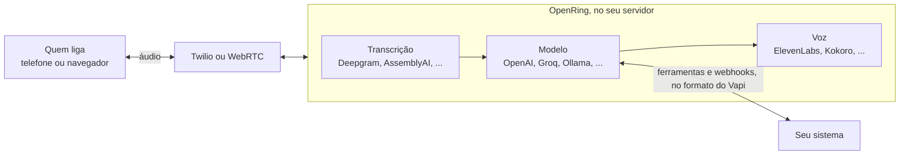

<div align="center">


# OpenRing

**Agentes de voz com IA no seu servidor, com API compatível com o Vapi. Sem taxa de plataforma.**

Agentes de telefone e recepcionistas com IA que atendem e fazem ligações pelo Twilio, Telnyx, Plivo, Vonage ou qualquer
tronco SIP, com as suas chaves ou uma stack grátis e 100% local (Whisper, Ollama, Kokoro).

[](https://github.com/elifalanrocha/openring/actions/workflows/ci.yml)
[](https://www.npmjs.com/package/openring)
[](https://pypi.org/project/openring/)
[](LICENSE)

[](#-começo-rápido)
[](#-migrar-do-vapi)

[Começo rápido](#-começo-rápido) · [Como funciona](#-como-funciona) · [Comparação](#-comparação) · [Provedores](#-provedores) · [Roadmap](ROADMAP.md) · [English](README.md)

</div>

As plataformas de voz cobram uma taxa por cada minuto de cada ligação, em cima do que você já paga de
transcrição, modelo, voz e linha telefônica. O OpenRing faz o mesmo trabalho no seu computador ou servidor,
com as suas chaves, e fala o mesmo JSON do Vapi.

- 💸 **Sem taxa de plataforma, nunca.** Você paga Deepgram, OpenAI, Twilio ou quem escolher, direto, pelo preço deles.
- 🔁 **Compatível com o Vapi.** Mesmo JSON de assistente, mesmos nomes de provedor, ferramentas e webhooks:
  um cliente do Vapi migra trocando a URL base, e o **Import** copia uma conta com um clique.
- 🖥️ **Seu.** Chaves, ligações e transcrições ficam na sua máquina. Sem telemetria.
- 🆓 **Grátis para testar.** Vem com uma voz local grátis (Kokoro): a primeira ligação de teste não custa nada.

<p align="center">
  
  <br><sub>O painel, com dados de exemplo.</sub>
</p>

<table>
<tr>
<td width="50%"><br><b>Visão geral.</b> Ligações, minutos, tempo de resposta e quanto os provedores cobraram.</td>
<td width="50%"><br><b>Cada ligação.</b> Transcrição, latência por turno, custo por provedor e cada troca de provedor com o motivo.</td>
</tr>
<tr>
<td width="50%"><br><b>Assistentes.</b> Transcrição, modelo (ou uma rota) e voz, na ordem em que a ligação passa por eles.</td>
<td width="50%"><br><b>Rotas de modelo.</b> Mais rápido, mais barato, estável ou do seu jeito, com a velocidade medida e o preço de cada modelo.</td>
</tr>
</table>

## ⚡ Começo rápido

Basta ter o [Node.js](https://nodejs.org) 18 ou mais novo. O resto, inclusive o Python, se instala sozinho:

```bash
npx openring
```

O painel abre em http://localhost:8000. A partir dele:

1. **Crie uma senha.** O primeiro acesso pede uma (só deste computador).
2. **Conecte os provedores** na página **Providers**: Deepgram para a fala (contas novas ganham US$ 200 de
   crédito) e um modelo, por exemplo o plano grátis do Groq ou o login de um clique do OpenRouter. Cada chave
   é conferida com o provedor antes de ser salva.
3. **Crie um assistente** em **Assistants**: saudação, instruções, modelo e voz.
4. **Converse com ele.** Clique em **Test** e fale no microfone. Não precisa de número.
5. **Dê um número a ele** quando quiser: veja [Ligações por telefone](#ligações-por-telefone).

As configurações ficam em `~/.openring/.env`, criado na primeira execução com uma chave de API gerada para os
apps que chamam a API (ela aparece em **Settings**). A voz grátis Kokoro se baixa sozinha na primeira
execução (cerca de 120 MB). Esqueceu a senha? `openring --reset-password`.

## 🧭 Como funciona



Cada ligação roda um pipeline do [Pipecat](https://github.com/pipecat-ai/pipecat): a fala vira texto, o
modelo responde (e pode chamar suas ferramentas) e a voz fala a resposta. A latência de cada turno é medida,
etapa por etapa, e aparece no painel.

## 📊 Comparação

|  | OpenRing | Vapi | Retell | Dograh |
|---|---|---|---|---|
| Código | ✅ Aberto (MIT) | ❌ Fechado | ❌ Fechado | ✅ Aberto (BSD-2) |
| Taxa de plataforma | ✅ Nenhuma | US$ 0,05/min | US$ 0,055/min | Nenhuma no self-hosted, US$ 0,01/min na nuvem dele |
| Rodar no seu servidor | ✅ `npx openring`, sem precisar de Docker (Docker também funciona) | ❌ Nuvem deles | Nuvem deles; on-premise nos planos Enterprise | ✅ Com Docker |
| Ligações e transcrições | ✅ No seu servidor, sem telemetria | Nuvem deles | Nuvem deles; on-premise nos planos Enterprise | No seu servidor quando self-hosted; telemetria anônima, a não ser que você desligue |
| API compatível com o Vapi | ✅ Troque a base URL, importe uma conta | (é o Vapi) | ❌ | ❌ |
| Stack local grátis | ✅ Whisper, Ollama, Kokoro | ❌ | ❌ | ✅ Modelos abertos hospedados por você |
| Ligações simultâneas | Sem limite próprio, seu servidor decide | 4, depois US$ 10 por linha ao mês | 20, depois US$ 8 por ligação ao mês | 10 por padrão no self-hosted, dá para aumentar; 10 na nuvem dele |
| Modelo reserva | ✅ De qualquer provedor, quando um falha ou fica lento | Só do mesmo provedor, na OpenAI e no Bedrock | ✅ Assume quando o modelo principal falha ou fica lento | — |
| Linhas telefônicas | Twilio; Telnyx, Plivo e Vonage; só entrada no Genesys; qualquer operadora por tronco SIP via UDP | ✅ Twilio, Vonage, Telnyx, SIP | ✅ Twilio, Telnyx, SIP | ✅ Twilio, Vonage, Telnyx, Plivo, Vobiz, Cloudonix, Asterisk |
| Campanhas | Toda linha que faz ligações, sem nova tentativa por enquanto | ✅ | ✅ | ✅ Com nova tentativa |
| Base de conhecimento (RAG) | ✅ Grátis, no seu servidor, por palavras; ou a sua própria busca | ✅ Google Gemini, ou o seu servidor | ✅ | ✅ |
| Vários assistentes numa ligação | ✅ Squads, no formato do Vapi | ✅ Squads | ✅ | ✅ |
| Editor visual de fluxos | ❌ Fora dos planos por enquanto | Canvas para squads | ✅ | ✅ |
| Ligações pelo WhatsApp | ❌ Ainda não | — | — | ✅ Só entrada |

— significa que não encontramos na documentação pública deles. Em todas você também paga modelo, voz e linha
telefônica, e transcrição também, exceto que a página de preços do Retell não lista cobrança separada por ela. Com o
OpenRing, o servidor, a disponibilidade e qualquer trabalho de compliance ficam com você; as plataformas hospedadas
cuidam dos dois primeiros e ajudam com o terceiro (para HIPAA, o Vapi cobra US$ 2.000 por mês e o Retell diz que não há
custo extra). Preços e recursos das páginas públicas e da documentação de cada empresa em 8 de novembro de 2026 (preços conferidos nesse dia); confira
antes de decidir. O OpenRing não tem vínculo com nenhuma delas.

## 🔁 Migrar do Vapi

Copie todos os assistentes, ferramentas e números do Twilio de uma conta numa requisição só (ou clique em
**Import** na página Assistants). A chave é usada uma vez e não fica salva; importar de novo atualiza o que
veio antes.

```bash
curl -X POST http://localhost:8000/import \
  -H "Authorization: Bearer $OPENRING_API_KEY" -H "Content-Type: application/json" \
  -d '{"baseUrl": "https://api.vapi.ai", "apiKey": "SUA_CHAVE_PRIVADA_DO_VAPI"}'
```

A resposta lista cada assistente com o que ainda o impede de atender aqui (por exemplo, um provedor que o
OpenRing ainda não suporta). Depois, aponte a URL base do seu cliente para o seu servidor e o voice webhook
de cada número do Twilio importado para `$PUBLIC_URL/twilio/voice`.

## 📖 Guia da API

Toda requisição leva `Authorization: Bearer $OPENRING_API_KEY`. Os exemplos completos (ferramentas, mensagens
para o servidor, ligações feitas) estão no [guia em inglês](README.md#-api-guide).

**Sem servidor próprio? Use `apiRequest`.** O modelo preenche o `body` e o OpenRing envia para a sua URL: um
webhook do n8n, Make ou Zapier, a API do seu CRM. A URL, os `headers` e os `parameters` são seus, não do modelo, e
aceitam `{{variáveis}}` (menos no host da URL). A chave vai nos `headers`, que ficam no seu servidor: o `credentialId`
do Vapi não existe aqui. Resposta fora de 2xx conta como falha, e nada é repetido nem redirecionado, para uma
reserva não sair duas vezes. Exemplo no [README em inglês](README.md#tools).

**Ferramentas: trate os argumentos como entrada não confiável.** Quem escolhe os argumentos é o modelo, durante a
conversa com quem ligou, e quem liga consegue induzi-lo ("cancele todos os horários"). O seu servidor deve
conferir quem está ligando (`call.customer.number`), o que essa pessoa pode ver ou mudar, e limites. Configure
`server.secret` e confira o `X-Vapi-Secret`. Não coloque segredos no prompt de sistema.

Crie um assistente em português:

```bash
curl -X POST http://localhost:8000/assistant \
  -H "Authorization: Bearer $OPENRING_API_KEY" -H "Content-Type: application/json" \
  -d '{
    "name": "Recepção",
    "firstMessage": "Olá! Como posso ajudar?",
    "model": {"provider": "openai", "model": "gpt-4.1-mini",
              "messages": [{"role": "system", "content": "Você é uma recepcionista simpática. Responda em português."}]},
    "voice": {"provider": "11labs", "voiceId": "SEU_VOICE_ID"},
    "transcriber": {"provider": "deepgram", "model": "nova-3", "language": "pt-BR"}
  }'
```

### Base de conhecimento

Envie arquivos e o assistente consulta durante a ligação. As mesmas chamadas do Vapi: `POST /file` e uma ferramenta
`query`, ou **Knowledge** no painel e as caixas no editor do assistente. Aceita PDF, .docx, texto, Markdown, CSV, JSON,
YAML, XML e logs, até 20 MB cada. PDF escaneado não tem texto para ler, PDF que leva mais de 3 minutos para ser lido é
recusado, e .doc antigo precisa virar .docx.

A busca roda no seu servidor, de graça, em milissegundos e sem baixar nada. Ela **procura palavras, não significados**: o
modelo escolhe as palavras e tenta outras quando nada volta, e um arquivo curto vai inteiro para o modelo. Em documentos
longos, diga nas instruções quando buscar e use os termos dos arquivos. Para busca por significado, use a sua:
`provider: "custom-knowledge-base"` com `server.url`, que recebe o `knowledge-base-request` do Vapi. A importação copia as
ferramentas `query`, mas não os arquivos: envie de novo e liste os novos ids.

### Squads

Vários assistentes numa ligação, cada um com suas instruções, ferramentas, modelo e voz: um atende e passa a pessoa para
um especialista, que recebe a conversa até ali. O mesmo JSON do Vapi em `POST /squad`, ou **Squads** no painel:

```json
{"name": "Recepção", "members": [
  {"assistantId": "ID_RECEPCAO", "assistantDestinations": [
    {"type": "assistant", "assistantName": "Financeiro", "description": "a pessoa pergunta sobre uma fatura",
     "message": "Um momento, vou passar para o financeiro."}]},
  {"assistantId": "ID_FINANCEIRO"}
]}
```

O primeiro atende. Use `squadId` num número ou em `POST /call`. A ferramenta `handoff` faz o mesmo com mais controle e
funciona sem squad; `contextEngineeringPlan` define o que o próximo recebe da conversa, e o registro da ligação guarda
tudo em `handoffs` e na transcrição. Limites, gravação e webhooks vêm do primeiro assistente. Ainda não: destinos
`dynamic`, handoff para um squad inteiro, `variableExtractionPlan` e squads em campanhas.

### Troncos SIP

Qualquer operadora que fale SIP, sem Twilio no meio, pagando o preço da operadora. O OpenRing fala SIP e RTP (G.711, por
UDP) sozinho. O mesmo JSON do Vapi: uma credencial `byo-sip-trunk` em `POST /credential` e um número `byo-phone-number`,
ou **Phone numbers > SIP trunks** no painel. Ligações entram e saem pelo tronco, campanhas também, e `transferCall` usa
SIP REFER; se a outra linha não atender, a pessoa volta para o assistente.

**A operadora precisa alcançar seu computador por UDP**, na porta 5060 e nas portas de áudio 40000-40999: precisa de
servidor com endereço público ou redirecionamento de portas; túnel web não serve. Nada escuta até salvar um tronco, e o
OpenRing só responde aos gateways dos seus troncos, para não virar alvo de fraude. Com a sua operadora, o que muda é só o endereço do servidor SIP
(`gateways[].ip`), o login do tronco e, se ela pedir, `sipRegisterPlan`; um PBX como Asterisk funciona igual, com o endereço
dele como gateway. Ainda não: SIP por TCP ou TLS, detecção
de caixa postal e outros codecs. Nenhuma operadora real passou por aqui ainda, então conte como foi.

### Provedor reserva

Mesmos campos do Vapi (`transcriber.fallbackPlan.transcribers`, `model.fallbackModels`,
`voice.fallbackPlan.voices`). Se um provedor falha no meio da ligação de um jeito que tentar de novo não
resolve (chave recusada, crédito acabado, provedor fora do ar), o próximo da lista assume até o fim. Diferente
do Vapi, o modelo reserva pode ser de outro provedor: `"fallbackModels": [{"provider": "openai", "model":
"gpt-4.1-mini"}]`. Quando o modelo troca, o novo responde a última fala de quem ligou. Exemplo completo no
[README em inglês](README.md#provider-fallback).

### Rotas de modelo

Uma rota é uma lista de modelos em ordem, salva uma vez e usada por vários assistentes, como os combos do
OmniRoute. Crie na página **Model routes** (ou `POST /model-route`) e escolha no editor do assistente. A ligação
começa no primeiro modelo; o próximo assume quando um falha (chave recusada, crédito acabado, limite, fora do ar)
ou, com `maxLatencyMs`, quando demora mais que isso para começar a responder: a requisição lenta é cancelada e
o próximo responde a mesma fala. O modelo que falhou ou ficou lento descansa por `cooldownMinutes`, e as
próximas ligações já começam no seguinte até ele voltar.

O `preset` decide a ordem e esses dois números: `fastest` (a resposta mais rápida medida primeiro; troca depois
de 1,5 s), `cheapest` (o menor preço primeiro, modelos locais antes dos pagos; 3 s), `reliable` (a sua ordem;
2 s, e quem falha descansa 15 min) ou `custom` (você escolhe `order`, `maxLatencyMs` e `cooldownMinutes`). O
"mais rápido" usa o tempo até a primeira palavra nas ligações recentes; **Measure speed** na página da rota
mede cada modelo com uma resposta curta. Mexer num ajuste de uma rota com preset a torna `custom`. Exemplo no
[README em inglês](README.md#model-routes).

### Quanto custa cada ligação

Cada ligação grava quanto os provedores cobram, a preço de tabela, nos campos do Vapi: `cost` (US$) e
`costBreakdown.llm`, `.stt`, `.tts` e `.total`; o painel mostra por ligação e por minuto. A linha telefônica
ainda não entra. Provedor sem preço conhecido aparece em `costBreakdown.unpriced` e fica fora do total. Para
usar os seus preços, escreva `~/.openring/prices.json` ([formato no README em inglês](README.md#what-a-call-costs)).

### Limites da ligação

A ligação termina sozinha depois de `maxDurationSeconds` (10 minutos por padrão) ou depois de
`silenceTimeoutSeconds` sem atividade (30 segundos por padrão; o relógio espera enquanto alguém fala, o modelo pensa
ou uma ferramenta roda), com o `endedReason` do Vapi; antes, o assistente
diz o `endCallMessage`. Se a pessoa fica quieta depois que o assistente falou, ele diz uma das
`messagePlan.idleMessages` ("Você ainda está aí?"), até `idleMessageMaxSpokenCount` vezes. No painel, ficam
no editor do assistente.

### Nomes que o transcritor precisa acertar

Passe as palavras que ele vai ouvir: nomes, marcas, produtos. Use os campos da Vapi, ou **Words to recognize** no editor
do assistente:

```json
{"transcriber": {"provider": "deepgram", "model": "nova-3", "language": "pt-BR",
                 "keyterm": ["Clínica Sorriso", "Doutora Ana"]}}
```

`keyterm`, `keytermsPrompt` e `keywords` (uma palavra, com reforço opcional: `Sorriso:2`) são aceitos, até 100 palavras de
até 50 caracteres, e vão para o campo que cada transcritor usa: o nova-3 da Deepgram usa `keyterm` e recusa `keywords`, e
os modelos antigos o contrário, então o OpenRing manda o certo. Frases não cabem nos modelos antigos da Deepgram.
Funciona com Deepgram, AssemblyAI, ElevenLabs, `ink-2` da Cartesia e Whisper; Gladia e Soniox ignoram, com um aviso no log.

### Gravar ligações

Com `"artifactPlan": {"recordingEnabled": true}`, ou **Record calls** no editor do assistente, cada ligação vira um
arquivo WAV no seu servidor, com quem ligou à esquerda e o assistente à direita, cerca de 2 MB por minuto no
telefone e 6 MB no navegador. Fica numa
pasta `recordings` ao lado do banco. A página da ligação toca o áudio; `GET /call/{id}/recording` pede a chave da
API, e `DELETE /call/{id}/recording` apaga de vez. Gravações são apagadas depois de 365 dias: mude em **Settings >
Recordings** ou com `PATCH /settings/recordings {"retentionDays": 90}` (0 guarda para sempre).

Vem **desligada**, ao contrário do Vapi. A LGPD e leis de outros países podem exigir avisar a pessoa ou pedir o
consentimento dela: diga isso na saudação e confira as regras de onde você e quem liga estão.

### Ligações por telefone

O Twilio precisa alcançar o seu servidor por uma URL https pública. No seu computador, abra um túnel
(`cloudflared tunnel --url http://localhost:8000`), coloque a URL dele em `PUBLIC_URL` no
`~/.openring/.env` e reinicie. Depois cadastre o número do Twilio e aponte o **Voice webhook** (HTTP POST)
dele para `$PUBLIC_URL/twilio/voice`:

```bash
curl -X POST http://localhost:8000/phone-number \
  -H "Authorization: Bearer $OPENRING_API_KEY" -H "Content-Type: application/json" \
  -d '{"number": "+15551234567", "assistantId": "ID_DO_ASSISTENTE"}'
```

Ligue para o número. As transcrições ficam em `GET /call` e na página **Calls**. Para o assistente ligar
para alguém, use o mesmo corpo do `POST /call` do Vapi (ou **Call a phone** no painel). Ligue só para quem
espera a ligação: ligações automáticas são reguladas (as regras da Anatel no Brasil, a TCPA nos EUA).

**Caixa postal:** com `voicemailDetection` ou um `voicemailMessage` no assistente, a detecção do Twilio
vê quem atendeu e espera o bipe. Na caixa postal, o assistente deixa o `voicemailMessage` na própria voz (ou toca
um áudio, se for a URL de um .wav ou .mp3) e desliga com `endedReason: "voicemail"`; sem recado, só desliga. Vem
desligada: a pessoa ouve a saudação alguns segundos depois, e o Twilio cobra uma pequena taxa por ligação.

**Telnyx (ainda não confirmada numa ligação real):** no portal da Telnyx, crie uma **TeXML Application**
com a voice URL `$PUBLIC_URL/telnyx/voice` (HTTP POST) e associe o número a ela. Cadastre o número no OpenRing
com `"provider": "telnyx"` e defina `TELNYX_API_KEY` e `TELNYX_PUBLIC_KEY` (Keys & Credentials > Public Key),
ou conecte a Telnyx pela página Providers. Para fazer ligações, informe a aplicação TeXML em `TELNYX_APPLICATION_ID` ou
`texmlApplicationId` no número. Transferência e detecção de caixa postal ainda não existem na Telnyx.

**Plivo (ainda não confirmada numa ligação real):** no console da Plivo, crie uma **Application** com Answer URL
`$PUBLIC_URL/plivo/voice` e Hangup URL `$PUBLIC_URL/plivo/status` (HTTP POST) e associe o número. Adicione o número com
`"provider": "plivo"` e defina `PLIVO_AUTH_ID` e `PLIVO_AUTH_TOKEN`, ou conecte pela página Providers.

**Vonage (ainda não confirmada numa ligação real):** no painel da Vonage, crie uma **Voice application** com webhooks
assinados, Answer URL `$PUBLIC_URL/vonage/voice` e Event URL `$PUBLIC_URL/vonage/event`, e associe o número. Adicione o
número com `"provider": "vonage"` e defina `VONAGE_APPLICATION_ID`, `VONAGE_PRIVATE_KEY` (o caminho do arquivo que a Vonage
deixa baixar) e `VONAGE_SIGNATURE_SECRET`, ou conecte pela página Providers.

**Genesys Cloud (ainda não confirmado numa ligação real):** o assistente atende dentro dos fluxos do
Architect, pelo **Audio Connector** do Genesys. Na página Providers, conecte **Genesys Cloud** (o botão
**Generate** cria a API key e o client secret; copie os dois antes de salvar). No Genesys, crie uma integração
Audio Connector com a URI `wss://SEU_HOST_PUBLICO/ws/genesys` (aparece na página Phone numbers) e essas duas
credenciais. No Architect, a ação **Call Audio Connector** escolhe o assistente pela variável de entrada
`assistantId`, ou cadastre o número discado no OpenRing com `"provider": "genesys"`. As outras variáveis de
entrada preenchem as `{{variáveis}}` do assistente. Na saída, `action` vale `finished` ou `transfer` (com o
número em `transferTo`), para o fluxo rotear a ligação. Conexão sem a API key e a assinatura do Genesys é
recusada.

### Campanhas

Um assistente liga para uma lista de pessoas, algumas por vez, com o mesmo corpo do `POST /campaign` do Vapi.
Cada pessoa recebe uma ligação de saída comum, com o `campaignId`, então transcrição e webhooks funcionam como
em qualquer ligação. No painel, **Campaigns > New campaign** aceita uma lista colada ou um CSV; as outras
colunas do CSV viram variáveis.

```bash
curl -X POST http://localhost:8000/campaign \
  -H "Authorization: Bearer $OPENRING_API_KEY" -H "Content-Type: application/json" \
  -d '{"name": "Lembrete de consulta", "phoneNumberId": "ID_DO_NUMERO", "assistantId": "ID_DO_ASSISTENTE",
       "maxConcurrency": 3,
       "schedulePlan": {"earliestAt": "2026-11-03T12:00:00Z", "latestAt": "2026-11-03T20:00:00Z"},
       "customers": [{"number": "+5511912345678", "name": "Maria",
                      "assistantOverrides": {"variableValues": {"horario": "15h"}}}]}'
```

A primeira mensagem e as instruções do assistente aceitam `{{customer.name}}`, `{{customer.number}}` e qualquer
chave de `variableValues`: `"firstMessage": "Oi {{customer.name}}, estou ligando para confirmar sua consulta
das {{horario}}."`. As ligações começam em `earliestAt` (ou na hora) e nenhuma nova começa depois de
`latestAt`. `PATCH /campaign/{id}` com `{"status": "cancelled"}` para a campanha. Se o servidor reiniciar, ele
retoma as campanhas sem ligar duas vezes para ninguém.

Ligue só para quem aceitou receber a ligação, no horário que a lei permite: ligações automáticas são
reguladas (as regras da Anatel no Brasil, a TCPA nos EUA). O painel pede essa confirmação em cada campanha.

## 🆓 Stack grátis

| Camada | Opção grátis |
|---|---|
| Transcrição | `"provider": "whisper"`: roda no seu computador, sem chave; ou o crédito de US$ 200 do Deepgram para contas novas |
| Modelo | `"provider": "ollama"` (local), `"provider": "groq"` (plano grátis) ou `"provider": "omniroute"` (gateway local grátis) |
| Voz | `"provider": "kokoro"`: roda na sua CPU, sem chave |
| Linha telefônica | Conta de teste (trial) do Twilio |

**100% local.** Whisper, Ollama e Kokoro juntos não custam nada por minuto, e o áudio da ligação não sai do
seu computador. No editor do assistente, clique em **Use the free local stack**, ou:

```json
"transcriber": {"provider": "whisper", "model": "base", "language": "pt-BR"},
"model": {"provider": "ollama", "model": "llama3.2"},
"voice": {"provider": "kokoro", "voiceId": "pf_dora"}
```

Antes, instale o [Ollama](https://ollama.com) e rode `ollama pull llama3.2`; a página Providers mostra se ele
está rodando e quais modelos tem. O Whisper baixa o modelo uma vez, quando um assistente o usa pela primeira
vez (`tiny` 75 MB, `base` 145 MB, `small` 480 MB; também `medium`, `large-v3` e `large-v3-turbo`). Usa a GPU
NVIDIA quando existe, senão a CPU: num notebook de 2018, uma frase de quatro segundos leva cerca de 0,6 s com
`tiny` e 1,2 s com `base`, e o dobro com `"language": "multi"`; escolha o idioma quando souber qual é.

## 🔌 Provedores

Os nomes são os mesmos do Vapi: o JSON de um assistente passa de um para o outro sem mudança. Conecte cada
um pela página **Providers** do painel, ou coloque a chave no `~/.openring/.env`.

- **Modelo:** `openai`, `anthropic`, `google` (Gemini), `groq`, `openrouter`, `deepseek`, `xai`, `cerebras`,
  `together-ai`, `deepinfra`, `perplexity-ai`, `mistral`, `fireworks`; locais e sem chave: `ollama`,
  `omniroute` (com `OMNIROUTE_API_KEY` quando a proteção por chave do OmniRoute está ligada) ou `custom-llm` com `model.url`.
- **Transcrição:** `deepgram`, `assembly-ai`, `gladia`, `soniox`, `cartesia`, `11labs`; local e grátis: `whisper`.
- **Voz:** `11labs`, `cartesia`, `deepgram` (Aura), `openai`, `rime-ai`, `neuphonic`, `smallest-ai`,
  `inworld`; local e grátis: `kokoro`.

**Quem liga em qualquer idioma.** Com `"language": "multi"` (**Follow the caller** no painel), a transcrição
detecta o idioma, o OpenRing pede ao modelo que responda nele e troque quando quem liga trocar, e uma voz da
ElevenLabs ou da OpenAI lê o idioma que receber. As vozes do Kokoro e do Deepgram falam um idioma cada; o painel
avisa quando você escolhe uma delas. Quem já tem chave do Deepgram tem uma voz rápida na nuvem:
`{"provider": "deepgram", "voiceId": "thalia"}`.

## 🐳 Docker

```bash
cp .env.example .env          # preencha suas chaves e OPENRING_PASSWORD
docker compose up --build     # painel e API em http://localhost:8000
```

Num servidor, coloque em `PUBLIC_URL` o endereço https dele para o Twilio alcançá-lo.

## ❓ Perguntas frequentes

**Dá para trazer meus assistentes do Vapi?** Sim. O OpenRing lê o mesmo JSON de assistente, os mesmos nomes de
provedor, ferramentas e webhooks. Aponte seu cliente para a URL do seu servidor, ou use **Import** para copiar
assistentes, ferramentas, squads e números do Twilio de uma conta.

**Dá para rodar um agente de voz de graça?** Sim, no seu computador: Whisper para transcrever, um modelo pelo Ollama
e a voz Kokoro não custam nada por minuto. Só a linha telefônica custa; ligação de teste pelo navegador não.

**Quais telefonias funcionam?** Twilio (entrada confirmada em ligações reais), e Telnyx, Plivo, Vonage, Genesys Cloud
e troncos SIP. Só o Twilio atendeu ligações reais até agora; os outros foram testados com operadoras simuladas. A [comparação](#-comparação) diz o que cada uma faz hoje.

**Quanto custa uma ligação?** O que os seus provedores cobram, nada mais. Cada ligação grava o custo por provedor a
preço de tabela, e o painel mostra quanto você gastou.

**Preciso de Docker ou GPU?** Não. `npx openring` instala tudo, Python incluso. GPU deixa a stack local mais rápida;
provedores na nuvem não precisam.

## 🧱 Princípios

O OpenRing nunca cobra por minuto, mantém suas chaves e dados na sua máquina, continua compatível com
clientes do Vapi, roda com um comando e diz com clareza o que funciona e o que ainda não. A lista completa,
e como decidimos o que construir, está no [PRINCIPLES.md](PRINCIPLES.md) (em inglês).

## 🤝 Contribuir

```bash
git clone https://github.com/elifalanrocha/openring && cd openring
pip install -e ".[dev,kokoro,whisper]"
pytest                 # alguns minutos, sem serviço pago nem internet
python -m openring
```

Pull requests pequenos entram mais rápido. Comece pelo [CONTRIBUTING.md](CONTRIBUTING.md) e pelas
[good first issues](https://github.com/elifalanrocha/openring/labels/good%20first%20issue). Falhas de
segurança, por favor, de forma privada: veja o [SECURITY.md](SECURITY.md).

## 💛 Apoie o projeto

O OpenRing é grátis, sem taxa de plataforma, e continua assim. Se ele economiza dinheiro para você, ajude a mantê-lo no
[Patreon](https://www.patreon.com/cw/elifalanrocha) ou por Pix (chave aleatória):

```text
0e0094ed-3545-4bff-991c-4b927633ac4a
```

Indicar para quem tem uma agência de agentes de voz ajuda tanto quanto.

## 📄 Licença

MIT. Sem vínculo com Vapi, Retell, Dograh ou Twilio. O OpenRing usa o
[Pipecat](https://github.com/pipecat-ai/pipecat) e outros projetos open source, creditados em
[THIRD_PARTY.md](THIRD_PARTY.md).
